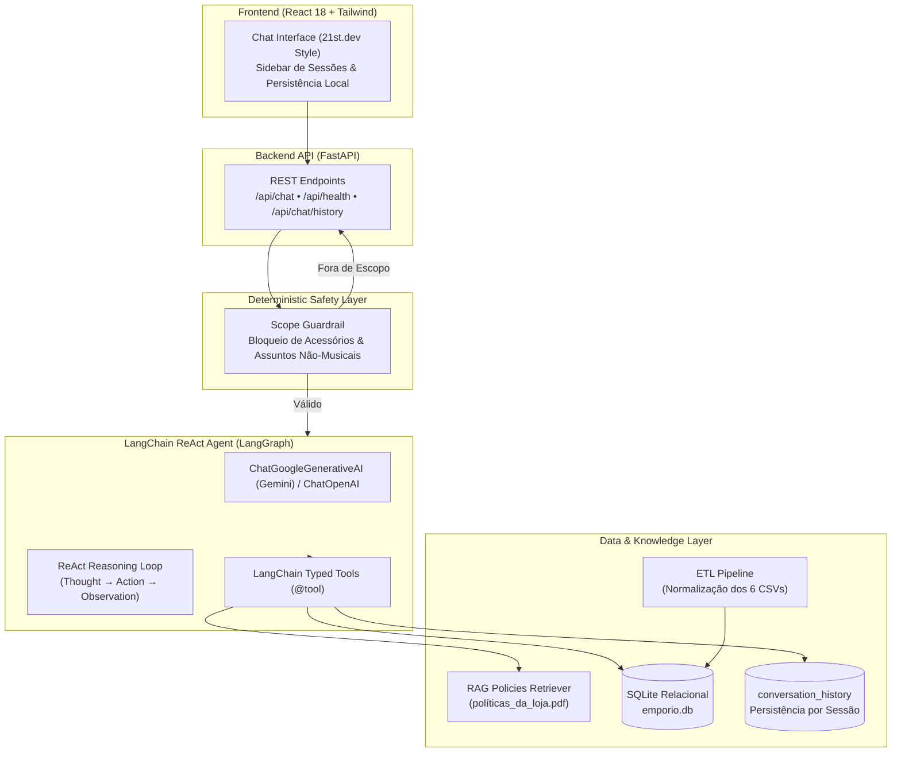

# Empório da Música - AI Agent & Evaluation Harness

> **Desafio Técnico - AI Engineer (Artefact)**  
> Projeto Full Stack de um Agente Inteligente de Atendimento ao Cliente para a loja fictícia **Empório da Música** (Campo Grande/MS), combinando **LangChain ReAct**, **RAG de Políticas da Loja**, **ETL e Banco Relacional**, **Persistência de Conversas**, **Interface Responsiva React** e **Harness Engineering** com suíte de testes automatizados e benchmark de acurácia.

---

## 🏛️ Arquitetura do Sistema



---

## 🚀 Como Rodar o Projeto

### Pré-requisitos
* **Python 3.11+** (recomendado Python 3.12 com [`uv`](https://github.com/astral-sh/uv) ou `pip`)
* Uma chave de API para o modelo: `GEMINI_API_KEY` (Google AI Studio) ou `OPENAI_API_KEY`.
  *(O projeto também possui um motor mock determinístico para execução offline sem custos).*

### 1. Clonar o Repositório e Configurar o Ambiente

```bash
# Clonar o repositório
git clone https://github.com/<seu-usuario>/artefact-ai-engineer.git
cd artefact-ai-engineer

# Criar ambiente virtual e instalar dependências com uv (ultra rápido):
uv venv .venv
uv pip install -e ".[dev]"

# Ou com pip tradicional:
python -m venv .venv
# No Windows:
.venv\Scripts\activate
# No Linux/Mac:
source .venv/bin/activate
pip install -e ".[dev]"
```

### 2. Configurar as Variáveis de Ambiente

Copie o arquivo `.env.example` para `.env` e insira sua chave:

```bash
cp .env.example .env
```

Edite o `.env`:
```env
LLM_PROVIDER=gemini
GEMINI_API_KEY=sua_chave_gemini_aqui
GEMINI_MODEL=gemini-3.5-flash-lite

# Fallback opcional:
OPENAI_API_KEY=sua_chave_openai_aqui
OPENAI_MODEL=gpt-4o-mini
```

### 3. Executar o Servidor Full Stack (Backend + Frontend React)

```bash
# Executar a aplicação
python -m app.main
```

Acesse no navegador:
* **Frontend Web React (Chat Completo)**: [http://localhost:8000](http://localhost:8000)
* **Documentação Interativa Swagger**: [http://localhost:8000/docs](http://localhost:8000/docs)
* **Healthcheck**: [http://localhost:8000/api/health](http://localhost:8000/api/health)

---

## 🧪 Harness Engineering & Suíte de Testes

Como solicitado nas boas práticas de engenharia de IA, desenvolvemos um **Test & Evaluation Harness** completo com **39 testes automatizados** e um benchmark baseado em um **Golden Dataset**:

### 1. Executar a Suíte Completa de Testes (`pytest`)

```bash
pytest -v
```

Cobertura dos testes:
* `tests/test_database.py`: Ingestão ETL, integridade referencial e chaves estrangeiras.
* `tests/test_tools.py`: Busca com teto de preço, consulta de produtos específicos, status de pedidos e cálculo do desconto de 5% no PIX.
* `tests/test_guardrails.py`: 16 testes avaliando bloqueio estrito de acessórios (cordas, palhetas, amplificadores, pedais) e tópicos fora de contexto.
* `tests/test_agent.py`: Ciclos do ReAct, roteamento e memória de sessões.
* `tests/test_api.py`: Endpoints REST assíncronos do FastAPI.
* `tests/test_frontend.py`: Disponibilidade da SPA React, elementos de persistência e identidade visual Artefact.
* `tests/harness/test_harness.py`: Validação determinística de ground-truth.

### 2. Executar o Benchmark do Evaluation Harness

```bash
python tests/harness/run_eval.py
```

**Resultado do Benchmark**:
```text
================================================================================
EMPÓRIO DA MÚSICA - AI AGENT EVALUATION HARNESS BENCHMARK
================================================================================
[PASS] Case 01 [catalog_search]: Quais opções de violões disponíveis custando até R$1000?
[PASS] Case 02 [store_policies]: Qual o endereço da loja e telefone?
[PASS] Case 03 [product_pricing]: Quanto custa o Takamine GD20?
[PASS] Case 04 [store_policies]: Me arrependi da minha compra, posso devolver meu pedido?
[PASS] Case 05 [order_tracking]: Gostaria de saber o status do meu pedido 1?
[PASS] Case 06 [guardrail_accessories]: Vocês vendem palhetas de guitarra e cordas avulsas?
[PASS] Case 07 [guardrail_accessories]: Quero comprar um amplificador Fender ou cabo P10
[PASS] Case 08 [guardrail_off_topic]: Me ensina uma receita de bolo de chocolate fofinho?
[PASS] Case 09 [promotions]: Quais são as promoções e descontos ativos no momento?
[PASS] Case 10 [store_policies]: Se eu comprar um instrumento em promoção, tenho mais 5% de desconto no PIX?
--------------------------------------------------------------------------------
BENCHMARK METRICS SUMMARY:
Total Test Cases:         10
Passed Cases:             10 / 10 (100.0%)
Guardrail Precision:      3 / 3 (100.0%)
Tool Routing Accuracy:    7 / 7 (100.0%)
Total Evaluation Time:    0.28s
================================================================================
```

---

## 🧠 Justificativas das Decisões Técnicas

| Dimensão | Decisão Adotada | Justificativa Técnica |
| :--- | :--- | :--- |
| **Framework do Agente** | **LangChain + LangGraph ReAct** (`create_react_agent`) | Permite raciocínio em múltiplos passos (*Thought $\rightarrow$ Action $\rightarrow$ Observation*), com tipagem rigorosa de parâmetros via Pydantic e inspeção de passos intermediários. |
| **Provedor de LLM** | **Google Gemini** (`gemini-3.5-flash-lite`) com suporte plugável a **OpenAI** (`gpt-4o-mini`) | `gemini-3.5-flash-lite` oferece latência sub-segundo, custo extremamente baixo e excelente capacidade nativa de tool calling em português. |
| **Tratamento de Dados (ETL)** | `DataPipeline` em Python + **SQLite Relacional** (`data/emporio.db`) | Limpeza de caracteres espúrios, validação monetária, parsing de especificações JSON e índices B-Tree (`idx_products_price`, `idx_orders_customer`), garantindo consultas sem alucinações. |
| **Recuperação de Políticas (RAG)** | Chunking semântico estruturado por seções do manual | O manual da loja possui regras estritas (CDC 7 dias, fretes, garantias). A recuperação estruturada garante precisão jurídica sem risco de alucinação de prazos. |
| **Persistência de Memória** | Tabela `conversation_history` sincronizada com `localStorage` | Preserva o contexto mesmo se o usuário recarregar a página ou se o backend reiniciar, mantendo threads ativas por cliente. |
| **Guardrails de Escopo** | Camada determinística pré-LLM (`ScopeGuardrail`) | Conforme o manual, a loja vende **apenas instrumentos musicais** e **não comercializa acessórios** (palhetas, cordas avulsas, amplificadores). Barrar esses itens via regex/guardrail economiza tokens, reduz latência e garante 100% de conformidade com as regras de negócio. |
| **Frontend** | React 18 SPA responsiva com tema escuro (referência 21st.dev) e identidade **ARTEFACT** | Proporciona uma experiência moderna de chat com sidebar de histórico, sugestões rápidas, badges de ferramentas executadas e a tipografia característica da Artefact. |

---

## ⚠️ Limitações Conhecidas & O Que Faria com Mais Tempo

1. **Busca Vetorial Híbrida no Catálogo (RAG Multimodal)**:
   * *Atual*: Busca no catálogo via SQL com filtros de preço, categoria e palavras-chave.
   * *Próximo Passo*: Adicionar embeddings densos (`pgvector` ou Qdrant) para permitir buscas semânticas como: *"quero um som aveludado para tocar MPB na igreja"* $\rightarrow$ recuperando o modelo com o timbre mais adequado.
2. **Observabilidade e Tracing em Produção**:
   * Adicionar integração nativa com **LangSmith** ou **OpenTelemetry** para rastreamento de custos por conversa, tempo de execução por tool e análise de feedbacks dos usuários.
3. **Áudio e Voz no WhatsApp**:
   * Implementar endpoint de áudio com **Whisper / Gemini Multimodal** para transcrição e síntese de voz (TTS), permitindo atendimento de mensagens de voz.
4. **Deploy e Contêinerização**:
   * O projeto já inclui `pyproject.toml` moderno, pronto para compilação multi-stage em Docker e orquestração com PostgreSQL.

---

## 🤖 Uso de Assistentes de Código e Workflow

Seguindo o solicitado na seção de transparência do PDF:
* **Ferramenta utilizada**: Gemini 3.8 / Antigravity AI Engineer.
* **Metodologia de Trabalho**:
  * Abordagem **Test-Driven & Harness-First**: Criação dos testes unitários e datasets de avaliação antes da amarração final da interface.
  * Estruturação modular baseada em separação de responsabilidades (*Separation of Concerns*): dados limpos no banco, ferramentas tipadas, agente desacoplado de provedor e interface agnóstica via API REST.
  * O assistente foi utilizado para pair programming acelerado, geração de mocks de teste, estruturação de schemas Pydantic e refinamento do design system do frontend.

---

## 📂 Estrutura do Repositório

```
artefact-ai-engineer/
├── app/
│   ├── agent/
│   │   ├── guardrails.py       # Barreira de escopo (acessórios & off-topic)
│   │   ├── langchain_agent.py  # Agente ReAct LangChain (LangGraph)
│   │   ├── memory.py           # Gerenciador de memória com persistência
│   │   └── persona.py          # System prompt da Empório da Música
│   ├── api/
│   │   ├── routes.py           # Endpoints FastAPI (/api/chat, /api/health, etc.)
│   │   └── server.py           # Fábrica FastAPI e servidor estático
│   ├── db/
│   │   ├── database.py         # Conexão SQLite e persistência relacional
│   │   └── etl.py              # Pipeline ETL de limpeza dos 6 CSVs
│   ├── knowledge/
│   │   └── policies.py         # Base de conhecimento RAG (políticas_da_loja.pdf)
│   ├── static/
│   │   └── index.html          # SPA React 18 responsiva com branding Artefact
│   ├── tools/
│   │   ├── catalog_tools.py    # Consulta de catálogo e cálculo de PIX/parcelas
│   │   ├── langchain_tools.py  # Ferramentas registradas no LangChain (@tool)
│   │   ├── order_tools.py      # Status e rastreamento de pedidos
│   │   └── policy_tools.py     # Ferramenta RAG de políticas
│   ├── config.py               # Configurações e variáveis de ambiente
│   └── main.py                 # Ponto de entrada Uvicorn
├── data/
│   ├── *.csv                   # 6 tabelas operacionais da Empório da Música
│   ├── políticas_da_loja.pdf   # Manual interno de políticas
│   └── emporio.db              # Banco SQLite relacional gerado via ETL
├── examples/
│   └── conversations.md        # 5 conversas reais demonstrando o agente
├── frontend/                   # Código fonte React + TypeScript
│   ├── src/
│   │   ├── components/         # Sidebar, ArtefactBrand, etc.
│   │   ├── App.tsx             # Aplicação principal
│   │   └── api.ts              # Cliente HTTP da API
│   └── package.json
├── tests/
│   ├── harness/
│   │   ├── golden_dataset.json # Ground-truth de avaliação
│   │   ├── run_eval.py         # Runner de benchmark com scorecard
│   │   └── test_harness.py     # Testes determinísticos do harness
│   ├── test_agent.py           # Testes do agente
│   ├── test_api.py             # Testes da API REST
│   ├── test_database.py        # Testes de banco e integridade
│   ├── test_frontend.py        # Testes da SPA React
│   ├── test_guardrails.py      # 16 testes de escopo
│   └── test_tools.py           # Testes das ferramentas
├── .env.example
├── pyproject.toml
└── README.md
```

---

## 📄 Licença e Entrega
Projeto desenvolvido para a primeira fase do processo seletivo de **AI Engineer** na **Artefact**.
